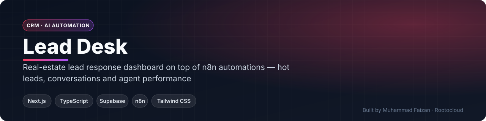
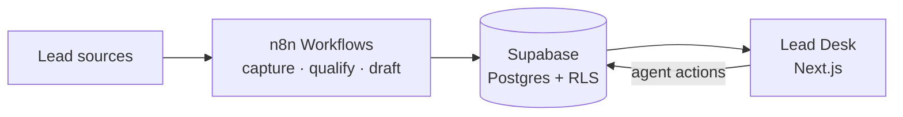

 

    

 

**[Request a live demo](https://rootocloud.com) · [Hire me](mailto:faizan.developer9200@gmail.com) · [More projects](https://github.com/MuhammadFaizan73)**

---

## 📌 Overview

Lead Desk is the human side of an AI lead-response system. n8n workflows capture and qualify leads and write to Supabase; this dashboard shows agents who needs a reply, the full conversation and response performance — multi-tenant with row-level security and magic-link login.

## ✨ Key Features

### Agents
- 'Needs you' queue: awaiting contact, hot leads and AI drafts
- Full conversation view per lead
- One-click 'I've texted them' tracking

### Managers
- All-leads overview
- Response-time performance metrics

### Platform
- Supabase Auth with magic links
- Tenant isolation with Row-Level Security
- Realtime updates on leads

## 🏗️ Architecture

## 🧰 Tech Stack

| Layer | Technology |
|---|---|
| **Framework** | Next.js · TypeScript · Tailwind CSS |
| **Backend** | Supabase (Postgres, Auth, Realtime, RLS) |
| **Automation** | n8n workflows |
| **Messaging** | SMS via workflow layer |

<!-- SCREENSHOTS -->
<!-- /SCREENSHOTS -->

## 🔒 About the Source Code

This is a **commercial / client project**, so the source code is kept in a private repository.
This page documents what the system does and how it is built.

- 🎥 **Live walkthrough** — available on request
- 💼 **Want something similar for your business?** I build custom versions of this for clients.

## 👨‍💻 Author

**Muhammad Faizan** — Founder, [Rootocloud](https://rootocloud.com)
AI agents & automation · Web & mobile apps · Custom software

© Muhammad Faizan. All rights reserved.

